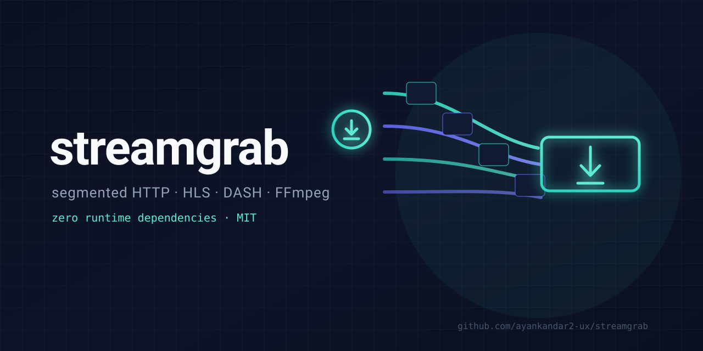
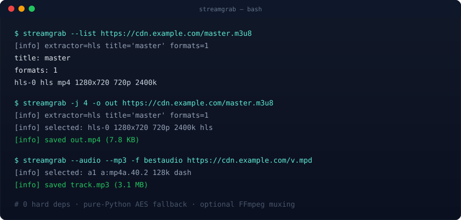
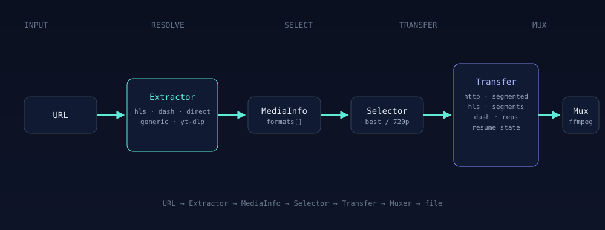

# streamgrab

[](https://github.com/ayankandar2-ux/streamgrab/actions/workflows/ci.yml)
[](https://github.com/ayankandar2-ux/streamgrab)
[](https://github.com/ayankandar2-ux/streamgrab)
[](LICENSE)
[](pyproject.toml)



**A modular, dependency-light media download engine for Python.**

`streamgrab` downloads video and audio from direct links, **HLS** (`.m3u8`) and
**DASH** (`.mpd`) manifests. It is a small, readable reference implementation of
the same layered design used by production downloaders: an **extractor** resolves
a URL to formats, a **transfer engine** fetches bytes in parallel with resume
support, and a **muxer** combines video + audio with FFmpeg.

- No hard runtime dependencies (standard library only).
- Optional pure-Python AES fallback for encrypted HLS; uses `cryptography` when installed.
- Optional FFmpeg integration for muxing / transcoding; degrades gracefully without it.
- Pluggable extractor interface.
- Tested on Linux, macOS and Windows across Python 3.9–3.13.

```
URL ──▶ Extractor ──▶ MediaInfo(formats) ──▶ Selector ──▶ Transfer ──▶ Muxer ──▶ file
         (resolve)                              (best/720p)   (HLS/DASH/HTTP)  (ffmpeg)
```

## Install

```bash
pip install streamgrab
# with the fast AES path:
pip install "streamgrab[crypto]"
```

From source:

```bash
git clone https://github.com/ayankandar2-ux/streamgrab
cd streamgrab
pip install -e ".[dev,crypto]"
```

FFmpeg is optional but recommended for muxing separate video/audio streams:

```bash
# macOS
brew install ffmpeg
# Debian/Ubuntu
sudo apt install ffmpeg
# Android/Termux
pkg install ffmpeg
# Windows: https://ffmpeg.org/download.html
```

## Android (Termux)

`streamgrab` runs natively in [Termux](https://termux.dev) on arm64/arm devices —
no root, no proot, no desktop. Termux ships a real Python 3 and a full FFmpeg build.

### One-shot install

```bash
pkg update && pkg upgrade
pkg install -y python ffmpeg git
git clone https://github.com/ayankandar2-ux/streamgrab
cd streamgrab
pip install -e "."
```

Or let the helper do it (updates packages, installs a prebuilt `cryptography`,
clones or pulls, installs, and sets up storage):

```bash
curl -fsSL https://raw.githubusercontent.com/ayankandar2-ux/streamgrab/main/scripts/termux-install.sh -o termux-install.sh
bash termux-install.sh
```

### Use the prebuilt AES backend

The pure-Python AES fallback works everywhere but is slow on a phone CPU.
Termux ships `cryptography` compiled for Android, so install the package instead
of building it with pip:

```bash
pkg install python-cryptography
python -c "import cryptography; print(cryptography.__version__)"
```

streamgrab detects it automatically — no configuration needed.

### Write to shared storage

Android 11+ scopes app storage, so grant access once and download into the
phone's normal Downloads folder:

```bash
termux-setup-storage                 # approve the Android permission prompt
streamgrab -o ~/storage/downloads/ "https://cdn.example.com/master.m3u8"
```

Files land in `~/storage/downloads` (the same folder the Files app shows).

### Keep long downloads alive

Android suspends background apps aggressively. For anything large:

```bash
pkg install termux-api
termux-wake-lock                     # hold a CPU wake lock
streamgrab -j 4 --retries 5 -o ~/storage/downloads/ "$URL"
termux-wake-unlock
```

Also set Termux to **Unrestricted** battery usage (Android Settings → Apps →
Termux → Battery), and consider `pkg install tmux` so a job survives the
terminal being backgrounded or the session being detached.

### Mobile tips

| Tip | Why |
|---|---|
| `-j 4` rather than `-j 16` | fewer sockets; less battery drain and thermal throttling |
| `--retries 5` | mobile networks drop connections more often than Wi-Fi |
| Download over Wi-Fi | segmented transfer will saturate a metered link |
| `--audio --mp3` | on-device conversion works once `pkg install ffmpeg` is done |
| Watch free space | Termux home lives on shared internal storage |

### Termux troubleshooting

| Symptom | Fix |
|---|---|
| `pkg: command not found` | You are not in Termux — open the Termux app itself. |
| `Permission denied` under `~/storage` | Run `termux-setup-storage` and approve the prompt. |
| `No space left on device` | `pkg clean`, delete old downloads, or target `~/storage/shared`. |
| `cryptography` build fails | `pkg install python-cryptography` instead of pip. |
| Download stalls with the screen off | `termux-wake-lock` + unrestricted battery. |
| `ffmpeg: not found` | `pkg install ffmpeg`; without it split A/V stays as separate files. |
| `pip` refuses to install | `pip install --user -e .` or `pkg install python-pip`. |

## Quick start

```bash
# List available formats
streamgrab --list "https://example.com/master.m3u8"

# Download the best rendition
streamgrab "https://example.com/master.m3u8"

# Pick 720p, 16 connections, into ./downloads
streamgrab -f 720 -j 16 -o downloads/ "https://example.com/master.m3u8"

# Audio only, as mp3
streamgrab --audio --mp3 "https://example.com/master.m3u8"

# DASH manifest
streamgrab "https://example.com/manifest.mpd"

# Authenticated request
streamgrab --cookies cookies.txt --header "Referer:https://example.com" "https://example.com/v.m3u8"
```

### Python API

```python
from streamgrab import Engine

engine = Engine(jobs=8, out_dir="downloads")
info = engine.resolve("https://example.com/master.m3u8")

for fmt in info.formats:
    print(fmt.format_id, fmt.protocol, fmt.height, fmt.label())

paths = engine.download(info, selector="best")
print("saved:", paths)
```

## Demo



## Architecture at a glance



## How it works

`streamgrab` is deliberately split into independent layers so each can be read,
tested and replaced on its own.

### 1. Extractors (`streamgrab/extractor/`)

An extractor maps a URL to a `MediaInfo` containing one or more `Format`s. It
never downloads media. Built-in extractors:

| Extractor | Handles |
|---|---|
| `HlsExtractor` | `.m3u8` master/media playlists |
| `DashExtractor` | `.mpd` manifests |
| `DirectMediaExtractor` | direct `.mp4/.webm/.m4a/...` links |
| `YtDlpExtractor` | optional bridge when `yt-dlp` is installed |
| `GenericExtractor` | HTML pages (`<video>`, OG/Twitter meta, JSON-LD, inline manifests) |

The registry tries extractors in priority order and falls back to the generic
HTML extractor last.

### 2. Transfer engine (`streamgrab/downloader.py`)

For plain HTTP files the engine probes the resource (`HEAD`, then a one-byte
range request if `HEAD` is blocked), splits it into byte ranges and downloads
them concurrently:

- **Segmented transfer** — one HTTP `Range` request per part, N workers.
- **Resume** — a `.sgstate.json` sidecar records each part's progress; parts are
  written to `.sgparts/` so an interrupted download continues where it stopped.
- **Automatic fallback** — servers that ignore `Range` get a single stream.
- **Integrity check** — the merged size is verified against `Content-Length`.

### 3. Adaptive streaming

**HLS** (`streamgrab/hls.py`) implements master/media playlist parsing,
`EXT-X-KEY` AES-128 decryption (with the pure-Python fallback), `EXT-X-MAP`
initialization segments, `EXT-X-BYTERANGE`, discontinuity tracking and
concurrent segment fetch. Segments are concatenated in order and optionally
remuxed to MP4 with FFmpeg.

**DASH** (`streamgrab/dash.py`) implements `SegmentTemplate` (including
`SegmentTimeline`), `SegmentList`, `SegmentBase`, `BaseURL` resolution and
separate audio/video representation selection. The best video and audio
representations are downloaded and muxed.

### 4. Muxer (`streamgrab/muxer.py`)

A thin, safe wrapper around `ffmpeg`/`ffprobe`:

- `mux(video, audio, out)` — combine streams without re-encoding (`-c copy`).
- `remux(src, out)` — repackage a container.
- `transcode_audio(src, out)` — extract/convert audio (e.g. to MP3).
- `concat(parts, out)` — lossless concatenation.

If FFmpeg is missing, streamgrab keeps the separate files and warns instead of
failing.

## Extending: custom extractors

Subclass `Extractor` and return a `MediaInfo`:

```python
from streamgrab.extractor import Extractor, default_extractors
from streamgrab.models import Format, MediaInfo

class MySite(Extractor):
    name = "mysite"
    priority = 50

    def matches(self, url):
        return "mysite.example" in url

    def extract(self, url, client, headers=None):
        return MediaInfo(
            title="My video",
            url=url,
            extractor=self.name,
            formats=[Format(format_id="720", url="https://cdn/720.m3u8",
                            protocol="hls", height=720)],
        )

engine = Engine(extractors=[MySite(), *default_extractors()])
```

See [`examples/plugins/example_site.py`](examples/plugins/example_site.py).

## Project layout

```
streamgrab/
├── streamgrab/
│   ├── engine.py          # orchestration: resolve → select → download
│   ├── downloader.py      # segmented, resumable HTTP transfer
│   ├── hls.py             # m3u8 parsing + download
│   ├── dash.py            # MPD parsing + download
│   ├── muxer.py           # ffmpeg / ffprobe wrappers
│   ├── crypto.py          # AES-CBC (cryptography or pure Python)
│   ├── http.py            # stdlib HTTP client
│   ├── models.py          # Format / MediaInfo
│   ├── cli.py             # command line interface
│   └── extractor/         # extractor plugins
├── tests/                 # unit + local-server integration tests
├── examples/plugins/      # sample extractor
└── docs/ARCHITECTURE.md   # deeper design notes
```

## Testing

```bash
python -m pytest -q
```

The suite includes unit tests for playlist/manifest parsing and the AES
implementation, plus integration tests that spin up a local HTTP server and
exercise the segmented downloader and HLS pipeline (plain and AES-128). CI runs
the full matrix on Ubuntu, macOS and Windows for Python 3.9–3.13.

## Case study

[`docs/SNAPTUBE-NOTES.md`](docs/SNAPTUBE-NOTES.md) is an architectural analysis
of a shipping Android downloader (SnapTube 7.70.1) and a layer-by-layer mapping
to streamgrab. It is static-analysis commentary only — no proprietary code or
assets are reproduced.

## Legal and responsible use

`streamgrab` is a general-purpose transfer tool. It does **not** include DRM
circumvention, site-credential cracking, or any site-specific bypass. Only
download content you own or have permission to download, and respect the terms
of service of the sites you access and the rights of content owners. You are
responsible for how you use it.

## License

MIT — see [LICENSE](LICENSE).
